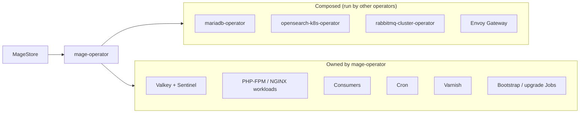

# mage-operator

Run Magento, Adobe Commerce or Mage-OS stores on Kubernetes from one `MageStore` resource. For teams running many shops or several environments.

<!-- PLACEHOLDER (card 3): demo GIF, max 30 s. docs/media/demo.gif does not exist yet; this image shows as broken until card 3 adds it. -->


> **Status: alpha (v0.6.x).**
>
> - **Works:** end-to-end on kind; validated on a real Scaleway Kapsule cluster.
> - **Not tested yet:** other clusters, including EKS, GKE, AKS, Hetzner and bare metal. [GAP: confirm the exact list of untested platforms with the maintainers.]
> - **Not for production yet.**
> - **CRD stability:** breaking changes only in minor versions, documented in [`CHANGELOG.md`](CHANGELOG.md).
> - **Next:** see the [roadmap](ROADMAP.md).

> Not affiliated with, endorsed by, or sponsored by Adobe Inc.
> "Magento" and "Adobe Commerce" are trademarks of Adobe Inc.
>
> Not related to Mage.ai.

## How it fits together

You create a `MageStore`. The operator composes four existing operators and owns the rest.



## Who this is for

**For you if you run:**

- Many shops, or the same shop in dev, staging and production with the same code path.
- Your own Kubernetes: Hetzner, Scaleway, bare metal, EKS, GKE or AKS.

**Not for you if you:**

- Run a single shop that is happy on a managed host.
- Use Adobe Commerce Cloud. ECE-Tools mode was dropped on purpose ([ADR 002](docs/internals/adr/002-config-emission-modes.md)).
- Need production-ready software today. This is alpha.

## How it compares

| Option | What it is | A fit when |
| --- | --- | --- |
| Hand-written manifests | You write and maintain every Kubernetes object | You run one shop and want full control |
| PHOENIX-MEDIA Helm chart | A Helm chart for Magento | [GAP: confirm scope and maintenance status] |
| Managed Magento hosting (for example Hypernode) | A hosting provider runs the platform | You do not want to run Kubernetes |
| Adobe Commerce Cloud | Adobe's hosted platform | You are on Adobe Commerce Cloud; mage-operator does not support it |
| mage-operator | An operator driven by one `MageStore` resource | You run many shops or environments on your own Kubernetes, and accept alpha |

Facts checked 16 October 2026: the Bitnami Magento chart was deprecated in September 2024, `graycoreio/magento2-helm` was archived in April 2025, and we found no other maintained Magento operator. Shopware has an official one.

## Getting help

- Questions: [GitHub Discussions (Q&A)](https://github.com/aknostic/mage-k8s-operator/discussions). [GAP: Discussions is currently disabled on the repository; enable it before launch.]
- Bugs: [GitHub issues](https://github.com/aknostic/mage-k8s-operator/issues).
- Vulnerabilities: follow [`SECURITY.md`](SECURITY.md). Do not use public issues.

## Commercial support

mage-operator is built and maintained by Aknostic, a platform engineering company in Utrecht. If you want help moving Magento to Kubernetes or running it, talk to the engineers who built this: [aknostic.com](https://[GAP: confirm aknostic.com landing page]/?utm_source=github&utm_medium=readme&utm_campaign=mage-operator-launch).

## Why use this

Run your Magento, Adobe Commerce, or Mage-OS store on Kubernetes
declaratively. You bring a container image; the operator owns the
Kubernetes shape — database, search, cache, queue, workloads,
routing, consumers, cron, media storage, optional Varnish.

Running Magento on Kubernetes for one shop is a solved problem:
write a Helm chart with your specific assumptions baked in.
Running it for many shops, or across dev / staging / prod with the
same code path, is not — everyone ends up with a slightly
different Helm chart, duplicating decisions about MariaDB
provisioning, Redis layout, consumer Deployments, cron groups,
Varnish VCL, multi-store dispatch, upgrade orchestration, and
public-edge TLS.

This operator lifts those decisions into a single CRD. You
describe *what* you want — a `MageStore` with N frontend
replicas, M consumer workers, S3 media, two storefront hosts,
your image — and the operator owns the *how*. It composes
existing operators (`mariadb-operator`, `opensearch-k8s-operator`,
`rabbitmq-cluster-operator`, Envoy Gateway) rather than embedding
their logic; the Valkey cache is run by the operator itself.

## Status

**v0.6.x — alpha.** The latest release is v0.6.4, published before
the project moved to GitHub; v0.7.0 will be the first release on
`ghcr.io`, and until then the operator is built from source. It
runs end-to-end on kind and has been validated on a real Scaleway
Kapsule cluster. v0.7.0 — a security baseline (NetworkPolicies,
workload `securityContext`, admin URL randomization) — is in
progress; see the `[Unreleased]` section of
[`CHANGELOG.md`](CHANGELOG.md).

The CRD shape is not yet frozen — breaking field changes are gated
to minor version bumps during the v0.x line and documented in the
CHANGELOG.

**Don't use this in production yet.**

## Quick install

If you have a Magento container image that honors the
[image contract](docs/image-contract.md), you can have a working
store on Kubernetes in ~5 minutes:

```bash
# 1. Install the dependency operators (MariaDB, OpenSearch,
#    RabbitMQ, Envoy Gateway). On a kind cluster:
curl -sSfL https://raw.githubusercontent.com/aknostic/mage-k8s-operator/main/scripts/dev-k8s-setup.sh | bash

# On any other cluster, install each operator manually — see
# docs/prerequisites.md for the per-operator install commands and
# version pins.

# 2. Build and install the operator. Until v0.7.0 is published on
#    ghcr.io, it is built from source; on kind:
git clone https://github.com/aknostic/mage-k8s-operator.git
cd mage-k8s-operator
make docker-build IMG=mage-operator:dev
kind load docker-image mage-operator:dev --name mage-operator-dev
helm install mage-operator charts/mage-operator \
  --set image.repository=mage-operator --set image.tag=dev \
  --namespace mage-operator-system --create-namespace
#    On any other cluster, push the image to a registry it can pull
#    from (make docker-build docker-push IMG=<registry>/mage-operator:dev)
#    and set image.repository / image.tag to match.

# 3. Apply a minimal MageStore pointing at your image.
kubectl apply -f - <<'EOF'
apiVersion: mage.aknostic.com/v1alpha1
kind: MageStore
metadata:
  name: store
  namespace: default
spec:
  image:
    repository: registry.example.com/myshop/magento
    tag: "2.4.8"
  workloads:
    frontend:
      replicas: 1
  bootstrap:
    admin:
      email: admin@example.com
EOF

# 4. Wait for Ready.
kubectl wait --for=condition=Ready magestore/store --timeout=10m
```

The admin password is operator-generated; retrieve it with
`kubectl get secret store-admin -o jsonpath='{.data.password}' | base64 -d`.

For more `MageStore` examples (pre-bootstrapped database,
multi-store, S3 media, Varnish enabled): see
[`docs/minimal-magestore.md`](docs/minimal-magestore.md) and the
field-by-field [`docs/magestore-reference.md`](docs/magestore-reference.md).

For production / HA configuration:
[`docs/operations/scaling.md`](docs/operations/scaling.md).

### Don't have a Magento image yet?

The repo includes a reference image at `magento-test-image/` that
satisfies the contract — useful for trying the operator end-to-end
on a local kind cluster without building your own image first.
The reference-image walkthrough lives in the [quickstart](docs/quickstart.md#using-the-reference-image-on-kind);
allow ~30 minutes for the first build (composer install +
`setup:di:compile` + `setup:static-content:deploy` are CPU-bound).

## Documentation

- **[`docs/quickstart.md`](docs/quickstart.md)** — end-to-end
  install on kind, including admin-panel access. Also covers the
  reference-image build path.
- **[`docs/minimal-magestore.md`](docs/minimal-magestore.md)** —
  smallest viable `MageStore` examples (pre-bootstrapped DB and
  fresh install).
- **[`docs/prerequisites.md`](docs/prerequisites.md)** — what
  needs to exist in your cluster before installing the operator,
  per-feature opt-out paths via `external` mode, and how to
  substitute alternative database / cache / search / queue
  operators.
- **[`docs/magestore-reference.md`](docs/magestore-reference.md)** —
  field-by-field reference for the `MageStore` CRD. Includes
  [`spec.routing.tls`](docs/magestore-reference.md#specroutingtls)
  — **public-edge TLS** via cert-manager Gateway API shim or BYO
  TLS Secret.
- **[`docs/operations/scaling.md`](docs/operations/scaling.md)** —
  HA configuration: stateless tier scaling, ref-mode recipes for
  the four data tiers, known v0.3.0-roadmap limitations.
- **[`docs/operations/upgrades.md`](docs/operations/upgrades.md)** —
  upgrading a `MageStore` via `spec.image.tag` changes.
- **[`docs/troubleshooting.md`](docs/troubleshooting.md)** —
  condition-by-condition reference: every `Reason` value the
  operator emits with "what it means" and "what to check."
- **[`docs/image-contract.md`](docs/image-contract.md)** — the
  operator ↔ image interface specification. Read this before
  building or adapting your own Magento image.
- **[`CHANGELOG.md`](CHANGELOG.md)** — release notes.

For contributors: [`docs/internals/`](docs/internals/) holds the
ADRs, release flow, SOPS workflow, and local SMTP setup.

## Cosign verification

Release container images (on `ghcr.io` from v0.7.0) are signed
with cosign. Verify before pulling into production:

```bash
cosign verify --key cosign.pub \
  ghcr.io/aknostic/mage-operator:vX.Y.Z
```

The public key (`cosign.pub`) is in this repo. From v0.2.0
onward, the Helm chart is signed alongside the image; release
flow detail at
[`docs/internals/releasing.md`](docs/internals/releasing.md).

## Contributing

Issues and pull requests welcome. Before opening a substantive
PR, please open an issue first and read the relevant
[ADR](docs/internals/adr/) — especially ADR 004 (the
seeded-but-extractable dependencies pattern) and ADR 006 (workload
naming + Gateway API routing). Match the commit-message style of
the existing log.

Local development setup, tests and the PR checklist are in
[`CONTRIBUTING.md`](CONTRIBUTING.md); the release flow and ADRs
live under [`docs/internals/`](docs/internals/). To report a
security issue, see [`SECURITY.md`](SECURITY.md).

## License

Apache License 2.0. See [`LICENSE`](LICENSE) for the full text.
